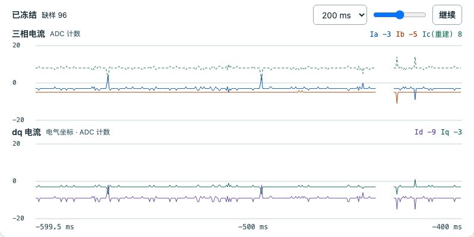

# 14 串口伺服

## 已确认需求

基于 03，保留 16 kHz 电流环、2 kHz 外环。位置与 MIT 均以上电位置为机械零点并累计多圈，释放期间继续测量。支持双向速度、Iq 力矩和五参数同步 MIT。主机每 50 ms 心跳，250 ms 超时关 MOE，重新使能须显式操作。运行参数在 RAM 中。

## 已确认架构

03 的 ADC 电流环负责正弦查表、闭环、过流及开桥预装载。SysTick 读取 SSI、展开机械角、滤速，在同一控制周期采用整组命令。位置比例产生限幅转速给速度 PI；力矩直接给机械 Iq；MIT 以度、rpm 求位置及速度偏差，加权再加前馈 Iq。机械 Iq 经 01 的标定方向映射一次。速度或位置命令限速，力矩及 MIT 同向驱动在达到限速时抑制，另设 660 rpm 故障阈值。无效编码器/供电/时序或过流关桥。串口工作在 spin 执行器，用定长 DMA 请求、CRC16 与序号。只有心跳续租，控制命令与查询不续租。

## 已确认 UI/UX

桌面 Chrome/Edge 本地 Web Serial 面板，1 Mbaud 8N1。按模式展示给定、增益、限制；反馈独立于待提交值。显式应用并使能、释放、状态及错误。最小窗口 640×480，诊断以原位反馈和对话框展示。

顶部显示串口、连接、设备模式与 MOE。中部在“控制”和“调参”两个视图间切换。控制视图有位置、速度、力矩、MIT 四种模式，只展示所选模式的给定；MIT 五项一起提交。调参视图包含速度和 Iq 上限、位置增益、速度 PI。两个视图共享反馈栏和释放按钮。草稿修改不发送；释放态“应用并使能”，已使能时“应用更新”，收到设备应答才显示生效。故障或心跳超时后需释放并重新使能。串口断开后禁用给定，保留最后读数并标明失联，MOE 显示未知。连接后先读取设备状态，切换编辑模式不改变运行模式。

界面验收：在 640×480 和 800×600 下切换两个视图、逐个打开四种模式，控件与底部读数均完整显示；键盘可完成连接、编辑、提交和释放；实时刷新保留未提交值；校验失败定位字段，断线不显示过时的运行状态。

## 需求跟踪

|编号|实现位置（14-uart-servo）|验收标准|状态|
|---|---|---|---|
|SER-01|src/servo.rs|位置±720°跨圈，速度±rpm，机械Iq正负，MIT同周期五参数与限幅|软件验证通过，待实板跟踪|
|SER-02|src/link.rs、src/protocol.rs、HAL usart|双向DMA、CRC拒错、心跳250 ms关MOE且重连释放|状态机验证通过，待实板|
|SER-03|host/|50 ms心跳、连接回读、四模式下发和反馈、单屏可用|模拟串口及布局验证通过|

变更：单圈位置草稿已按确认的四模式多圈需求替换。

## 阶段确认记录

- 需求：用户回复“确认”，覆盖四种模式、上电机械零位、多圈累计、MIT 五参数、RAM 调参、心跳与验收范围。
- 架构：用户回复“架构确认”，沿用四模式、双环、多圈计数及独立心跳看门狗方案。
- UI/UX：用户回复“界面方案确认”，按双视图、四模式、固定反馈及释放操作实施。
- UI/UX 确认后继续固件和上位机实现；本次未烧录。

## 验证记录

- 在 14 项目目录执行 cargo build --release --offline，thumbv6m-none-eabi 成功链接。按 ELF 可加载段物理地址计算 FLASH 为 34,936 字节，保留 01 标定及保护描述页。
- 独立测试固件中的纯计算代码。编码器正向两圈、反向四圈并跨零；MIT 的双向多圈误差、速度反馈、前馈和限幅；参数编解码、越界限流、CRC 标准向量；250 ms 临界点及计时回绕、故障拒绝使能、恢复心跳不自动使能。三个测试均通过。
- 桌面 Edge 以模拟 Web Serial 设备打开实际页面。验证 640×480 和 800×600 下两个视图与四个模式、MIT 帧字段与单位、拆分应答、周期心跳、反馈不覆盖草稿、释放和断开。浏览器测试未使用物理串口。
- 03-speed-loop 使用更新后的 HAL 和公共板级资源重新构建 release 成功。
- 主机未枚举到 USB-UART，probe-rs list 未发现调试探针。待实板验收包括 UART3 双向 DMA 在 1 Mbaud 下的收包与错误恢复、带载 16/2 kHz 时序、正反多圈及各模式跟踪、断开心跳后 MOE 实测关断时间。

### 首次实板启动

DAPLink SWD 400 kHz 两次烧录校验通过，Edge 已打开上位机，主机枚举到 /dev/cu.usbmodem1102。两次启动均读取到 11 对极、方向 −1、零点 6338；随后第一次 SSI 传输失败，固件停在启动检查，MOE 保持关闭，未进入 UART 服务。串口握手与电机跟踪验收仍待完成。

### 默认 SWD 速率复测与上位机实连

- 14 的 SPI3 引脚和传输配置与 03 一致。实板首次传输 PollTimeout，超时前 BUSY=1、RXNE=0；单纯延长轮询到 4096 次仍超时。HAL 超时恢复后释放 CS，再从新帧读取；此处理仅限启动的一次重试。两次 release 启动分别读到 2284 和 2285。
- 用户确认板上接线 PB11/PB12。14 独立分配 UART1，PB11/RX、PB12/TX。四个空闲 DMA 通道的 CNT 实读 0x00010000，HAL 对 L012 接受 CNT=0、REPEAT=1 的空闲组合，仍校验时钟、通道控制、地址、触发器和标志。
- 实板在 RX DMA 已完整搬运时仍报告 ORE；SWD 回读确认 CONNECT 帧头、序号及校验均存在。14 仅对其自同步 CRC 协议启用块内黏滞 ORE 处理，普通串口接收保留默认报错。
- SER-02/SER-03 实连：默认 runner 烧录，DAPLink cu.usbmodem1102，1 Mbaud；复测一条 CONNECT 和连续 20 条心跳均通过序号与 CRC 校验。较早一轮出现过一次截短回包，上位机对非驱动请求超时最多重试一次。Edge 实际页面显示“已连接 · 1 Mbps”，设备回报 MIT、MOE 已开启，位置 172.1°。本次联调未下发运动指令，其他模式及带载看门狗验收仍待测。

### 电流波形扩展

| 编号 | 已确认需求 | 验收 | 状态 |
|---|---|---|---|
| SER-04 | 2 kHz 同步采样，在现有 raw 协议上传输 | 按样本序号验证时间间隔，五路属于同一控制更新，丢样和关桥显示缺口 | 已完成，src/current_loop.rs、wave.rs、link.rs |
| SER-05 | 两图分别绘制 Ia/Ib/Ic 与 Id/Iq，共用时间轴，支持冻结放大 | 实时显示最近一秒；冻结放大时两图对齐，心跳、释放与超时行为正常 | 已完成，host/wave.js、panel.js、index.html |

架构已确认（用户回复“确认开始修改”）：ADC 控制每八次更新抽取一次，取控制器实际使用的 Ia/Ib 和同周期电气坐标 Id/Iq。主机由 Ia、Ib 重建 Ic。新增订阅操作和带序号、CRC 的独立波形帧；每批最多 16 组，原有控制应答优先，RX DMA 持续服务。上位机将设备采样时间与页面刷新解耦。开波形及冻结时均测试 50 ms 心跳，单独验证停止心跳后 250 ms 释放。

#### 电流视图 UI/UX（用户已确认）

沿用现有顶部连接、设备模式、MOE 状态及控制/调参导航，增加“电流”视图。上下两幅等宽图共享同一时间轴，上为 Ia、Ib、Ic（重建），下为 Id、Iq（电气坐标），单位均为 ADC 计数。实时窗口 1 秒。冻结时保留当前窗口；用时间跨度选择器在 1 s、200 ms、50 ms 间切换，用横向滑杆移动观察中心；点击继续回到最新 1 秒。共享游标在同一时刻读取五路数值。缺样与关桥以断线表示。释放按钮始终可见，冻结状态与实时设备 MOE 独立显示。640×480 及 800×600 验证单屏可操作。

用户确认停机烧录并以零 Iq 短时使能验证实板采样与看门狗。

#### SER-04 / SER-05 验证

最终 release 通过默认 SWD runner 烧录。用 PB11/PB12、UART1、1 Mbaud，建立连接、订阅、零 Iq 短时使能，发送 40 次周期心跳。收到 251 个通过 CRC 的 SW 批次，其中 3955 组有效；按设备序号差和主机收包时间估算 1993.9 组/s。5 次波形 CRC 失败，序号间共缺 96 组；实时图留空。最大心跳应答耗时 5.08 ms，最大发送间隔 55.1 ms。停止续租后，主机最后一次读到 MOE=1 和首次读到超时释放相距 247.48–252.48 ms（相对最后心跳的主机发送时间，非示波器边沿时间）。恢复心跳后仍释放，另测零 Iq 重新使能和主动释放通过。

在实际 Edge 引擎回放上述实板采样，验证 SW 分片、会话心跳、丢样断线、冻结时接收和心跳继续、三个显示时长、平移、继续和释放。640×480、800×600 均单屏显示。下图是这次零 Iq 的 200 ms 冻结窗口。

测试后修正：零 Iq 验收命令曾写入 120 rpm 并留在设备 RAM，造成随后 MIT 500 rpm 给定被拒。现场已将面板待应用速度上限恢复至 600 rpm，保留 MIT 给定并保持释放。后续验收从 CONNECT 应答复制当前五项调参值。

### SER-06 同步跟踪三相 PWM 指令

用户已确认在 2 kHz 电流波形中记录同次控制更新实际写入 ATIM 的 CCR1、CCR2、CCR3。上位机按 PWM 指令占空比绘制，游标可读原始计数；冻结、缩放、游标与两张电流图同步。验收覆盖样本对齐、缺样、冻结期间的心跳以及超时释放。状态为需求已确认，架构待确认，尚未实施或验证。

用户随后确认采集和传输架构。电流中断每八次取一组，在三个 CCR 均写入后捕获本次写入值与同次电流；每批 16 组，携带 ARR，通过现有 1 Mbaud UART DMA 传输。控制应答优先，主机冻结显示期间继续收包并维持心跳。当前阶段为 UI/UX 待确认。

### SER-07 外环优先级与停机诊断

用户确认 ADC1 P0、2 kHz SysTick P1、UART1/DMA P2，记录超时次数和首次关桥原因，并实测 100 rpm 开关波形订阅。实现位于 14 的 timing.rs、global.rs、servo.rs、current_loop.rs 和 link.rs；诊断通过 SR 应答 36–40 字节读回。

已烧录验证。两轮各从静止工况启动，测试使用烧录前读回的速度模式及原调参（600、200、4、125、6）。各测 15 秒，约 50 ms 读回一次；关闭订阅时编码器累计 23.57 圈，首秒后速度最小/中位/最大为 78/95/108 rpm；开启订阅为 23.52 圈、75/96/108 rpm，收到 1814 个有效波形批次。两轮超时计数均为 0，运行中首次关桥原因为 0，主动释放后均为 7。两轮均未复现停转。状态：该项验证通过。

#### SER-06 实施和验证

用户确认上、中、下依次显示三相电流、PWM 指令占空比、dq 电流。14 的 current_loop.rs 在写完 CCR 后取同次控制运算的四路电流与三个比较值；wave.rs 和 link.rs 实现带 ARR 的 236 字节 SP 帧，保留已有 SW 订阅。host/wave.js、panel.js、index.html 提供三图共享游标、冻结、缩放及原始 CCR 读数。

已用默认 runner 烧录。100 rpm 速度模式运行 15 秒，实际累计 23.57 圈，首秒后转速中位数 95 rpm，79–104 rpm，SysTick 超时及运行中首次关桥原因均为 0。串口读到 1623 个有效波形批次，批次间缺 3760 个采样，50 次 CRC 校验失败；成功心跳最大往返 10.8 ms，发送间隔最大 132.4 ms。约 2 kHz 为设备采样率，主机收到的数据存在缺口。首秒后有效样本的 ARR 均为 3060，三相最大与最小 CCR 之和离 ARR 最多 2 个计数。

实机 Edge 面板在电机运行时冻结，释放后放大到 200 ms，三图时间轴对齐。PWM 的三相峰顶与谷底可见浅凹口，三相错开。光标处 CCR 为 1853/1630/1206。面板保持已连接、已冻结、功率桥已释放。串口实测片段见 [100 rpm 同步波形](14-ccr-100rpm.svg)。状态为功能已验证，链路存在上述缺样。

### SER-08 波形分段对账和 SER-09 桌面上位机

已确认生成、发送前丢弃、DMA 完成、主机有效帧四段对账，保持 2 kHz 与 50 ms 心跳。在 100 rpm 修前基线中生成 1865 批，覆盖 210 批，DMA 完成 1655 批，主机接收 1592 批。总缺失 14.64%。心跳 RTT 中位数、P95、最大分别为 7.001、10.793、14.565 ms。修复改用有序队列，诊断操作 8 返回三个设备累计计数。在使用同一 DAPLink 的测试中，RTT 轮询期间仍有 DMA 完成后的串口缺口，停止轮询后独立运行的一轮收到全部 1861 批。该轮使用分段发送实验版本。

用户确认 Dioxus Desktop 保留原单屏布局，后台 Rust 线程负责串口与心跳。调参通过操作 9 读回、操作 10 在线写入 Id 和 Iq 各自的 Kp/Ki、速度 Kp/Ki、位置 Kp。参数在 RAM 生效，写参数不操作 MOE。

桌面入口位于 host/Cargo.toml，host/.cargo/config.toml 指定本机目标。已从 host 运行 cargo run，实际启动 aarch64-apple-darwin 的 servo-panel；固件根目录继续使用 thumbv6m 和 probe-rs。

最终无分段发送版本的 100 rpm 复测中，主机收到 141 批后串口设备消失，系统返回 ENXIO。该次没有完整的 15 秒最终对账数据，未验证断开后的 MOE 回读。
